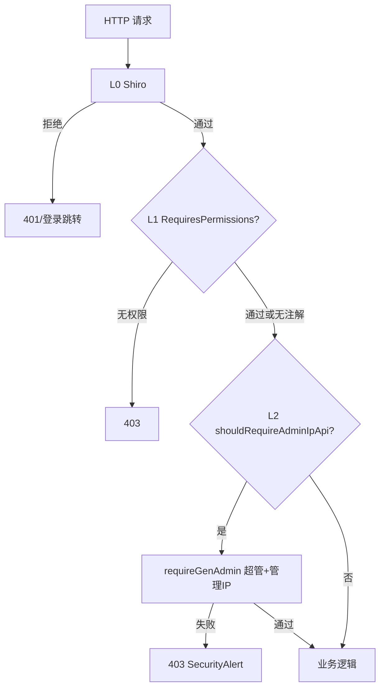

# 管理访问权限矩阵（超管 + 管理 IP）

> **用途**：对照业务 API / 后台页，判断是否需要 **系统管理员** 与 **`wall_ip_admin_white`（管理 IP）**。  
> **真相源（代码）**：`AdminAccessGuard`、`GenAdminAccessAspect`、`AdminAccessModuleHandler`、`IpAdminWhiteService`。  
> **接入标准**：[`AI_ADMIN_IP_BIZ.md`](AI_ADMIN_IP_BIZ.md)（模式 A/B/C）。  
> **兼容项**：[`AI_SECURITY_HARDENING_3_0_COMPAT.md`](AI_SECURITY_HARDENING_3_0_COMPAT.md) **C-20 / C-22 / C-23**。

**用语**：

| 符号 | 含义 |
|------|------|
| **强制** | 须已登录 **系统管理员**；若 **`SECURITY_OPS_CONFIG.adminIpEnable=true`** 另须客户端 IP ∈ **`wall_ip_admin_white`**（`requireGenAdmin` / `requireOpsAdmin`） |
| **否\*** | **本层（L2）不强制**；仍可能受 Shiro / `@RequiresPermissions` / 业务 Token 约束 |
| 超管 | `SysUserRoleService.isSystemAdministrator` |
| 管理 IP | `IpAdminWhiteService.checkAdmin`（与用户防拉黑 `wall_ip_white` 隔离；受 `adminIpEnable` 控制，**默认关**） |

生产 profile **勿**叠 `dev`/`h2`/`sqlite`：`Config.isDev()` 下 `checkAdmin` 会短路。`adminIpEnable=false`（默认）时非 dev 也不验管理 IP。

客户端 IP：配置 `autumn.client-ip.trusted-proxies` 后按列表从 XFF 右侧剥离。未配置时：公网 `remoteAddr` **忽略** XFF；回环/私网 `remoteAddr`（本机 Nginx / Docker）取 XFF **最右一跳**。Nginx 应对后端 **覆盖** `X-Forwarded-For $remote_addr`，勿 append 客户端原值。

---

## 1. 门禁分层（先分清层，再查表）

| 层 | 组件 | 管什么 | 不管什么 |
|----|------|--------|----------|
| **L0** Shiro Filter | `anon` / `authc` / `spm` 等 | 是否登录、匿名是否可达 | 超管、管理 IP |
| **L1** 菜单权限 | `@RequiresPermissions` | 角色菜单 | 管理 IP |
| **L2** 管理门禁 | `AdminAccessGuard` + `GenAdminAccessAspect` | **系统管理员**（+ 可选管理 IP） | 行级数据隔离 |
| **L3** 页面 | `gateView` / `@PageAware(admin=true)` | 后台页能否渲染 | REST 方法细节 |



**强制执行链（API）**：

1. 切面织入 / `ControllerGen` 显式调用 → `enforceAdminIpApiIfRequired`  
2. `shouldRequireAdminIpApi(type, declaringType, method, argCount)`  
3. 为 true → `requireGenAdmin` = `requireSystemAdmin` + `checkAdmin`

**重要**：Shiro `anon` **≠** 免 L2。集群口常标 anon，但仍可能被 L2 误拦（见 §5 C-23 事故对照）。

---

## 2. API 强制矩阵（L2）

切面织入（3.x）：

```text
within(*..modules..controller..*)
  || within(*..controller.gen..*)
  || within(cn.org.autumn.modules.install..*)
&& !@within(jakarta.websocket.server.ServerEndpoint)
&& execution(public * *(..))
```

织入后仍须 `shouldRequireAdminIpApi == true` 才强制。

### 2.1 场景对照表

| 场景 | 典型示例 | 超管 | 管理 IP | 兼容/备注 |
|------|----------|------|--------|-----------|
| 非自助 `*.controller.gen.*` CRUD | `SysUserControllerGen#list` | 是 | 是 | **C-20**；模板 + 切面双保险 |
| 继承 `*ControllerGen`，方法**声明在 Gen** | `ClientDetailsController` → Gen`#list` | 是 | 是 | **C-23** |
| 继承 Gen，子类方法带 `@RequiresPermissions` | `AppleClusterController#monitorMeta` | 是 | 是 | **C-23** |
| 继承 Gen，子类方法**无**注解，模块 ∉ `GEN_MODULES`∪`managedModules` | `AppleClusterController#notify` / `#nodes` | 否* | 否* | **C-23**；常配 Shiro anon |
| 继承 Gen，子类方法无注解，模块 ∈ `GEN_MODULES`∪managed | `ShieldController#attack` | 是 | 是 | 框架运维口不放行 |
| 模块 ∈ `GEN_MODULES`∪managed，手写 Controller，类名非 `*Api` | `ProfileController`、`DatabaseController` | 是 | 是 | 模块毯 |
| 同上，但类名 `*Api` / `*ApiController` | `LanguageApi#getSupportedLanguage` | 否* | 否* | **C-23** 防模块毯误拦 |
| 类名以 `AdminController` 结尾 | `OauthAsAdminController` | 是 | 是 | |
| SPI `managedModules()` 模块下手写 Controller | 业务仓模式 B | 是 | 是 | 见 AI_ADMIN_IP_BIZ |
| 自助 gen：`usr`/`safe`/`bot`/`qrc` + SPI `selfGenModules` | （仅未列入敏感名单的 Controller） | 否* | 否* | 仍受 L1；**无**默认行级隔离；禁止把 `usr:*`/`bot:*` 整包授给普通角色 |
| 敏感自助全表 | `UserProfile`/`UserLoginLog`/`Robot*`/`ScanTicket` gen / `ClientGrant` / Token/PIN 等（`SENSITIVE_SELF_GEN_CONTROLLERS`） | 是 | 是 | 全表无行级隔离 → **强制**超管+管理 IP；Hook/Grant/Token `secret` JSON `WRITE_ONLY`；Web 扫码子类扩展方法不连坐 |
| 固定豁免 Controller | Login / Page / Proxy / Wall / Spm / OAuth2·Bot·Qrc API 等 | 否* | 否* | §2.3 |
| 方法豁免 | `nav`、`info()`(0 参)、`password`、`self*`、`Shield#test` 等 | 否* | 否* | §2.3 |
| `install` 包 / 模块 | 安装向导 | 否* | 否* | 首装无白名单 |
| `@ServerEndpoint` | bugshut / 业务 WS 端点 | 否* | 否* | **C-22** 排除织入与判定 |

### 2.2 `shouldRequireAdminIpApi` 判定顺序（与源码一致）

按顺序短路；任一步「豁免」则 **不强制**；命中「强制」则返回 true。

1. `type == null` → 否  
2. `@ServerEndpoint` → 否（C-22）  
3. 模块 `install` 或包名含 `.modules.install.` → 否  
4. 固定豁免 Controller（§2.3）→ 否  
5. 方法豁免（§2.3）→ 否  
6. **声明类**为受限 gen（`*.controller.gen.*` 或 `*ControllerGen`，且非自助）→ **强制**  
7. 目标类 `extendsRestrictedGenController`：  
   - 有声明类且声明不在 Gen 上：  
     - 方法有 `@RequiresPermissions` → **强制**  
     - 否则模块 ∈ `GEN_MODULES`∪`managedModules` → **强制**  
     - 否则 → 否（业务子类公开/集群口）  
   - 无声明类（gen 模板保守调用）或声明即 Gen → **强制**  
8. 模块 ∈ `GEN_MODULES`∪`managedModules`：  
   - 类名 `*Api` / `*ApiController` → 否  
   - 否则 → **强制**  
9. 类名以 `AdminController` 结尾 → **强制**  
10. 否则 → 否  

切面路径会传入 **方法声明类**（`MethodSignature`）；`ControllerGen.java.vm` 显式调用常无声明类 → 走保守分支。

### 2.3 固定豁免清单（L2）

**Controller 简单名豁免**：

`SysLoginController`、`SysPageController`、`SysProxyController`、`SysUsingController`（`/sys/using` 机器探测，头 `Authentication`=UsingFactory.key）、`AuthLoginProviderController`、`AdminBootstrapController`、`WallController`、`SpmController`

**包/类名片段豁免**：

| 片段 | 说明 |
|------|------|
| `.oauth.oauth2.` / `.opl.oauth2.` | OAuth2 协议面 |
| `.bot.controller.RobotApi` / `RobotInbound` | 机器人开放 API |
| `.qrc.controller.QrcApi` | 二维码开放 API |
| `.opl.controller.OplApi` / `.opc.controller.OpcApi` | 开放平台 API |

**方法豁免**：

| 条件 | 说明 |
|------|------|
| 方法名以 `self` 开头 | 自助会话 |
| `snoozePasswordReminder` / `acknowledgePasswordReminder` | 口令提醒 |
| `SysMenuController#nav` | 登录用户导航 |
| `SysUserController#password` | 本人改密 |
| `SysUserController#info` 且实参个数 = 0 | 本人资料；`info(uuid)` **仍强制** |
| `ShieldController#test` | 防火墙探测（只读 403，不再写入护盾放行集） |

---

## 3. 页面 / View 矩阵（L3 · `gateView`）

入口：`AdminAccessGuard.gateView`（经 `SysPageController` / SPM 等）。

| 视图类型 | 判定 | 登录 | 超管 | 管理 IP | 失败表现 |
|----------|------|------|------|---------|----------|
| `@PageAware(admin=true)` / 后台壳 | `isAdminPageView` / `isAdminShellView` | 是 | 是 | 是 | 404 + `SecurityAlert` |
| OPS 运维页 | `isOpsView`（§4 `OPS_VIEWS`） | 是 | 是 | 是（wall 特殊） | 一般 404；**wall** 可进页但锁内容 + 临时密码认领 |
| GEN 模块页 `modules/{m}/…` | `isGenGlobalView`（m ∈ GEN_MODULES∪managed） | 是 | 是 | 是 | 404 |
| 定制管理页 | `CUSTOM_MANAGE_VIEWS` | 是 | lockdown 时仅超管；否则超管 **或** 有菜单 | 是 | 404 |
| 自助模块页 | `SELF_MODULES` 且非管理后缀 | 按 PageAware / Spm | 否* | 否* | — |
| 其它 `modules/**`、`pages/**` | 默认兼容 | Spm 等 | `adminLockdown` 时仅超管 | — | lockdown 时 404 |

`wall.html`：超管可渲染；仅当 `adminIpEnable=true` 且管理 IP 未加白或引导态 → `wallIpLocked`，用引导密钥 / `clearToken` 认领当前 IP（勿直接当普通 404）。安全设置含「管理IP校验」开关（关须 clearToken；开自动认领当前 IP）。

Cookie 写操作另受 `SECURITY_AUTH_CONFIG.csrfEnforce` + `X-CSRF-Token`（与 L2 正交）。

---

## 4. 常量集合（源码 SSOT）

定义于 `AdminAccessGuard`（SPI 可扩展部分见 `AdminAccessModuleHandler`）。

| 常量 | 值 | 用途 |
|------|-----|------|
| `GEN_MODULES` | `sys`, `wall`, `db`, `job`, `gen`, `oss`, `lan`, `spm`, `node` | API 模块毯 + 页面 `isGenGlobalView` |
| `SELF_GEN_MODULES` | `usr`, `safe`, `bot`, `qrc` | gen CRUD **不**强制超管+IP |
| `SELF_MODULES` | `usr`, `safe`, `docs`, `bot`, `qrc`, `oauth`, `opc`, `opl`, `client`, `auth` | 页面自助判定 |
| `OPS_VIEWS` | `exec`, `redis`, `cache`, `queue`, `database`, `dbmanage`, `tablescan`, `loopjob`, `cluster`, `loginlog`, `log`, `logger`, `session`, `threading`, `thread`, `functionqueue`, `reinit`, `fieldencrypt`, `configsecure`, `shield`, `scan`, `wall`, `siteportal`, `firewall`, `plugin`, `classpath`, `clear` | 运维高危页 |
| `CUSTOM_MANAGE_VIEWS` | `oauthasmanage`, `authscopemanage`, `oauthrpmanage`, `oplmanage`, `opcmanage`, `connectbind` | 定制管理页 |
| `SELF_MODULE_ADMIN_SUFFIXES` | 含上表 + `clientdetails`, `tokenstore`, `encryptkey`, `openapp`, … | 自助模块内仍属管理控制台的叶子页 |

SPI：

| 方法 | 作用 |
|------|------|
| `managedModules()` | 追加「全局管理」模块短名（与 `GEN_MODULES` 同语义） |
| `selfGenModules()` | 追加「自助 gen」豁免（**禁止**把全站业务模块塞入） |

---

## 5. 业务对照判定卡（三步）

对任意业务接口，按顺序回答：

```text
① Shiro：anon / authc / 其它？
   → anon 只说明「可不登录」；不能推出「免超管+管理 IP」。

② L2：按 §2.1 表 / §2.2 顺序，是否「强制」？
   → 是：必须超管 Session + 管理 IP 白名单（日志关键字 SecurityAlert denied）。
   → 否*：进入 ③。

③ 若不强制：是否仍有 @RequiresPermissions / 业务 Token / 签名？
   → 有：按 L1 或业务鉴权。
   → 无且 Shiro anon：对公网等价于公开面（需产品确认）。
```

### 5.1 最近事故对照（C-23 修复后预期）

| URI / 能力 | 形态 | L0 | L2 预期 | 说明 |
|------------|------|----|---------|------|
| `/ios/applecluster/notify\|nodes\|node` | 继承 Gen 的子类扩展、无 `@RequiresPermissions`，模块 `ios` ∉ GEN_MODULES | 常 anon | **不强制** | 修复前整类连坐 → `system_admin_unauthenticated`；级联「未找到合适的签名服务器」 |
| `/api/getsupportedlanguage` | `LanguageApi`，模块 `lan` ∈ GEN_MODULES | 视 Filter | **不强制**（`*Api`） | 修复前模块毯误拦 |
| `/lan/language/put` | `LanguageController#put` 子类扩展、无注解；集群 Feign 注册 | 常需登录会话 | **不强制**（方法豁免） | 修复前 `lan` 模块毯 → `system_admin_forbidden` |
| `/xsign/xsignappconfigdispatch/getQQGroupList` | 子类扩展、无注解，`xsign` ∉ GEN_MODULES | 视 Filter | **不强制** | 同 C-23 |
| `/xsignw/xsignjobvacancypublish/getJobCount` | 子类扩展、无注解，`xsignw` ∉ GEN_MODULES | 视 Filter | **不强制** | 同 C-23 |
| gen CRUD `list/save/…` | `*.controller.gen.*` | 通常需登录 | **强制** | 未变 |
| `/sys/node/*` | `ProfileController`，`node` ∈ GEN_MODULES | 需登录 | **强制** | C-20 |

检索拒绝日志：`SecurityAlert denied reason=…`（如 `system_admin_unauthenticated`、`ops_admin_forbidden`、`admin_ip_white`）。

---

## 6. 与其它文档分工

| 文档 | 内容 |
|------|------|
| **本文** | 对比矩阵 + 判定顺序 + 常量集 + 判定卡 |
| [`AI_ADMIN_IP_BIZ.md`](AI_ADMIN_IP_BIZ.md) | 业务仓如何接入（模式 A/B/C） |
| [`AI_SECURITY_HARDENING_3_0_COMPAT.md`](AI_SECURITY_HARDENING_3_0_COMPAT.md) | 升级兼容 C-20/C-22/C-23 |
| [`AI_STANDARDS.md`](AI_STANDARDS.md) §14 | PageAware / gen 硬约束摘要 |

**禁止**在各业务仓再维护第二套矩阵；业务仓只链到本文，并用 SPI 声明 `managedModules` / `selfGenModules`。

---

## 7. 相关源码索引

| 组件 | 位置 |
|------|------|
| 判定 / `gateView` / `requireGenAdmin` | `autumn-modules` … `AdminAccessGuard` |
| 切面 | `autumn-modules` … `GenAdminAccessAspect` |
| SPI | `autumn-handler` … `AdminAccessModuleHandler` |
| 管理 IP | `IpAdminWhiteEntity` / `IpAdminWhiteService` |
| gen 模板 | `template/ControllerGen.java.vm`（显式 `enforceAdminIpApiIfRequired`） |
